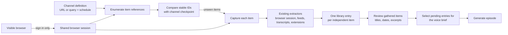

# Voice Brief Channel Architecture

## Purpose

An ordinary capture turns one URL, file, or text value into one library item.
A voice-brief channel watches a durable location, discovers new item references,
and sends every unseen item through that same capture path.

Channels orchestrate captures. They are not a second extraction system.

## Schematic



## Shared with ordinary capture

- Canonical URLs and provenance.
- Site-specific extraction.
- Logged-in browser sessions when required.
- Article readability, YouTube transcripts, podcast media, and social content.
- Workspace input extensions.
- Validation, retries, media handling, and library storage.

The shared capture result remains a title, normalized content, source URL, and
optional media.

## Channel-only responsibilities

- Revisit a profile, feed, listing, search, or podcast.
- Enumerate ordered item references.
- Assign and retain stable item identities.
- Compare the result with previously seen identities.
- Capture only unseen items.
- Preserve partial successes and report channel health.
- Apply a schedule and choose captured entries for an episode.

Enumeration returns references, not combined content. Five independent posts
therefore become five captures and five library files.

Related content belongs to its parent when it completes that item. An X post,
its same-author continuation thread, and its attached X article become one
capture.

## Runtime boundary

The channel workflow exposes two operations:

1. **Enumerate** a channel into item references.
2. **Capture** one item using the existing capture pipeline.

The voice-brief service depends only on those operations. It does not choose between
a “standard” extractor and a browser path.

The visible browser exists only to establish authentication. Background workflows
reuse the same native WebKit session.

Gathering and generation are separate user actions. **Check channels** updates
the pending queue and its preview; **Generate voice brief** consumes that
reviewed queue without refreshing it again.

## Library UI

The existing sidebar-and-reader shell has three scopes:

- **Item** lists independent captured documents.
- **Channel** treats each channel as a folder containing its captured items;
  selecting the folder opens channel configuration.
- **Voice brief** treats each voice brief as a folder containing its generated
  episodes; selecting the folder opens the brief definition.

Channel and voice-brief configuration lives in the reader pane, not Settings.

## Extensibility

Item extraction continues to use the existing workspace input extension system.
Built-in channel enumeration currently covers feeds, YouTube channels, Apple
Podcasts, Hacker News, arXiv, ordinary pages, and authenticated X profiles.

Current default policies are deliberately small:

- Podcast page or feed: latest episode.
- YouTube channel: latest video.
- X profile: latest five unique, non-pinned posts.
- Hacker News front page: top five stories.
- Ordinary feeds: every unseen item returned by the feed.

A future channel-extension hook should add only enumeration:

```ts
enumerate(channel, context): Promise<ItemReference[]>
```

It should return stable IDs and URLs; the shared capture pipeline remains
responsible for content.

## Implementation direction

1. Keep the voice-brief workflow centered on channels and make
   `enumerate → checkpoint → capture` explicit.
2. Reuse the existing extractor for ordinary item capture.
3. Keep authenticated X enumeration and thread/article expansion in the
   headless browser workflow.
4. Keep the persisted `sources` field temporarily for file compatibility while
   presenting it as **Channels** in the UI.
5. Add workspace channel-enumerator extensions only when a real third-party
   channel requires one; do not duplicate the existing item-extension API.
